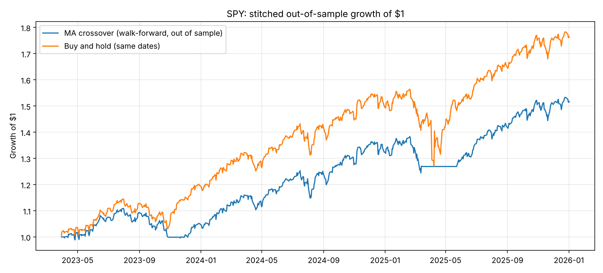
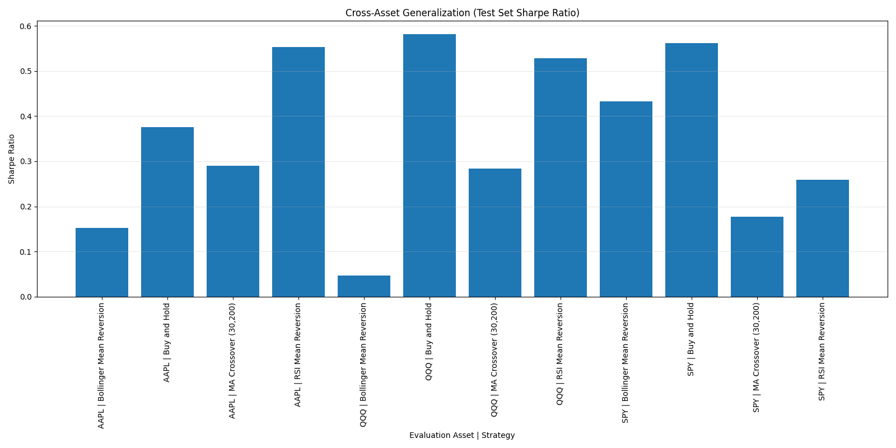
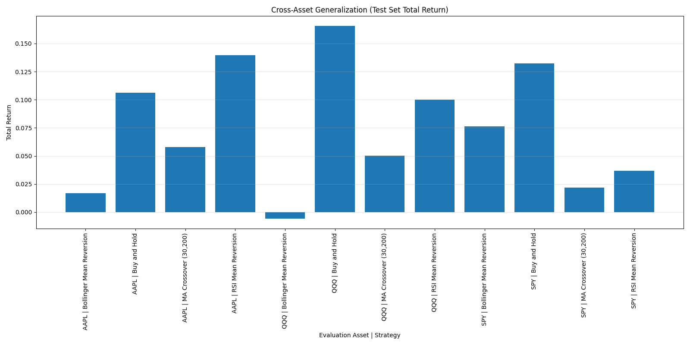
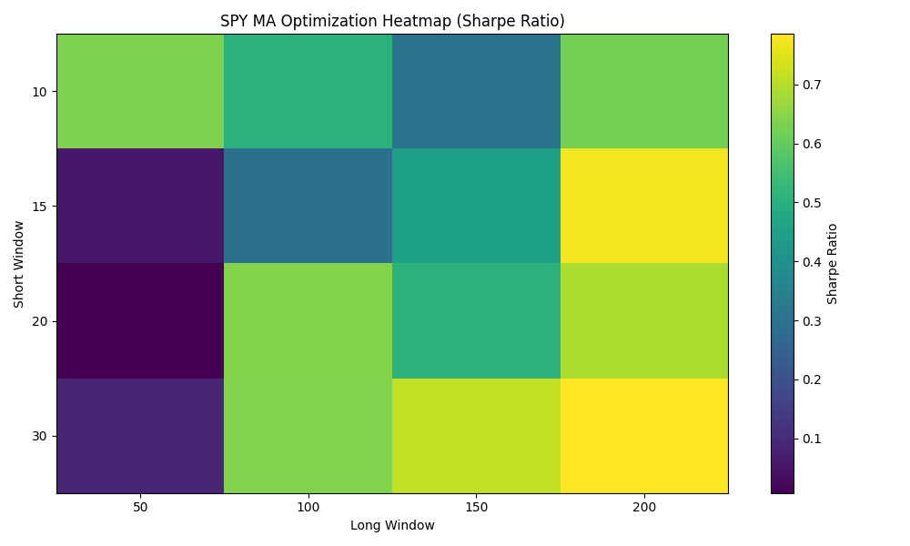

# Quantitative Trading Strategy Backtester & Cross-Asset Generalization Study


A Python backtesting framework for daily equity/ETF strategies, plus a small research study on whether
strategies tuned on one asset (SPY) transfer to others (QQQ, AAPL).

- Four strategies: moving-average crossover, RSI mean reversion, Bollinger mean reversion, buy-and-hold benchmark
- Chronological 70/30 train/test split, with MA windows chosen on the training set only
- **Walk-forward validation**: windows re-chosen every quarter on a trailing two-year window, traded on the next unseen quarter
- 0.1% transaction cost charged on every position change (entry and exit)
- Risk metrics: Sharpe, Sortino, Calmar, max drawdown, volatility, trade statistics
- 28 pytest tests covering look-ahead, cost accounting, split integrity, optimizer, and walk-forward folds

---

## Research paper

**Do Technical Trading Strategies Generalize Across Assets?**
[Read the paper (PDF)](research/Do%20Technical%20Trading%20Strategies%20Generalize%20Across%20Assets.pdf)

MA windows are tuned on SPY's training split and applied unchanged to QQQ and AAPL; RSI and Bollinger use
fixed parameters. The code that produces the study is in [`research/research_generalization.py`](research/research_generalization.py).

> **Correction:** the paper's Limitations section says transaction costs are not modeled. That is wrong: both
> the main backtest and the research script charge 0.1% per position change. Slippage and market impact are
> not modeled.

---

## How it avoids look-ahead bias

- **Signals trade the next day.** `Position = Signal.shift(1)`, so a signal computed from day *t*'s close only earns day *t+1*'s return.
- **Chronological split.** Train/test is a positional `iloc` split; every training date precedes every test date.
- **Parameters never see the test set.** The 16 MA window pairs (short 10/15/20/30 × long 50/100/150/200) are ranked by training-set Sharpe only.
- **Walk-forward SMAs are trailing.** Rolling means use only past prices, so computing them before slicing folds adds no future information.

All four properties are covered by tests in [`tests/`](tests).

---

## Results

Data: daily adjusted closes from Yahoo Finance, March 2021 to March 2026. Costs included for all active strategies.

### Single 70/30 split (test period, out of sample)

| Ticker | Strategy | Total return | Sharpe | Max drawdown | Trades |
|---|---|---:|---:|---:|---:|
| SPY | Buy and hold | 13.2% | 0.56 | −18.8% | 1 |
| SPY | MA crossover (30,200) | 2.2% | 0.18 | −12.3% | 2 |
| SPY | RSI mean reversion | 3.7% | 0.26 | −7.2% | 4 |
| SPY | Bollinger mean reversion | 7.6% | 0.43 | −10.5% | 9 |
| QQQ | Buy and hold | 16.6% | 0.58 | −22.8% | 1 |
| QQQ | MA crossover (15,200) | 7.4% | 0.38 | −13.2% | 2 |
| QQQ | RSI mean reversion | 10.0% | 0.53 | −7.8% | 3 |
| QQQ | Bollinger mean reversion | −0.6% | 0.05 | −10.9% | 6 |
| AAPL | Buy and hold | 10.6% | 0.38 | −33.4% | 1 |
| AAPL | MA crossover (15,50) | −0.1% | 0.08 | −28.1% | 6 |
| AAPL | RSI mean reversion | 14.0% | 0.55 | −10.4% | 6 |
| AAPL | Bollinger mean reversion | 1.7% | 0.15 | −17.5% | 7 |

Buy-and-hold has the best Sharpe on SPY and QQQ; RSI mean reversion edges it on AAPL. Every active strategy
has a smaller maximum drawdown than buy-and-hold. With only 2 to 9 trades per test period, none of these differences is
statistically meaningful on its own.

### Walk-forward validation (MA crossover)

504-day training window, 63-day test window, 11 non-overlapping quarterly test folds from March 2023 to January 2026.

| Ticker | OOS Sharpe | Buy-and-hold Sharpe | OOS return | Buy-and-hold return | OOS max DD | Buy-and-hold max DD | Folds beating B&H | Distinct window pairs chosen |
|---|---:|---:|---:|---:|---:|---:|---:|---:|
| SPY | 1.38 | 1.43 | 51.7% | 76.4% | −10.2% | −18.8% | 4 / 11 | 6 |
| QQQ | 1.41 | 1.37 | 81.6% | 99.3% | −13.6% | −22.8% | 6 / 11 | 4 |
| AAPL | 1.13 | 0.88 | 62.1% | 70.9% | −14.1% | −33.4% | 5 / 11 | 3 |



What this shows:
- Over a strong bull market, re-tuned MA crossover trails buy-and-hold in total return on all three assets.
- It roughly matches buy-and-hold on risk-adjusted return and cuts max drawdown by roughly 40 to 60%.
- On SPY the "best" window pair changed six times across 11 folds, so the single-split optimum is not stable.
  That instability is the main argument against trusting one in-sample optimization.

### Cross-asset generalization

| | |
|---|---|
|  |  |



Training-set Sharpe across the 16 window pairs ranges from 0.01 to 0.79, so parameter choice matters a lot
in sample. SPY's (30,200) pick carried over to AAPL's test period better than AAPL's own (15,50) optimum
(Sharpe 0.29 vs 0.08).

---

## Running it

```bash
pip install -r requirements.txt

python main.py                         # download data, optimize, backtest, write results/ and plots/
python walk_forward.py                 # walk-forward validation on the cached data (no network)
python walk_forward.py --train 252 --test 21 --cost 0.0005
python research/research_generalization.py
pytest -q                              # 28 tests, no network needed
```

## Project layout

```
src/
  data_loader.py     yfinance download and cleaning
  indicators.py      SMA, EMA, RSI, rolling volatility
  strategies.py      signal generation for the four strategies
  backtester.py      next-day execution, costs, equity curve, trade log
  metrics.py         return, risk, and trade statistics
  optimization.py    chronological split and MA grid search
  walk_forward.py    rolling train/test folds
  plots.py
main.py              single-split pipeline
walk_forward.py      walk-forward CLI
research/            generalization study and paper
tests/               pytest suite
```

## Limitations

- Long-only, single-asset, daily bars. No shorting, leverage, or position sizing.
- Flat 0.1% cost per position change; no slippage, spread, or market-impact model.
- Five years of data in a mostly rising market. Results say little about other regimes.
- Small trade counts, so performance differences are not statistically significant.

## Possible extensions

- Bootstrap or block-bootstrap confidence intervals for Sharpe differences
- Volatility-targeted position sizing
- Multi-asset portfolio backtesting
- Slippage modeled as a function of volatility or volume
